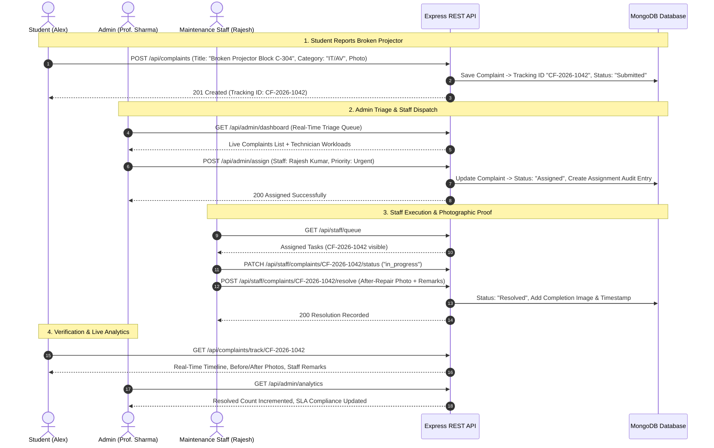

# CampusFix – Smart Campus Issue Management System

> **CampusFix – Next-Gen Campus Issue Reporting & Facility Management Platform**  
> *Production-Ready Full-Stack Web Application solving university infrastructure and facility maintenance challenges.*

---

## 1. Executive Summary

**CampusFix** is a production-ready, full-stack campus issue reporting and facility management platform built to bridge the gap between university students, campus estate administrators, and maintenance personnel.

### Problem It Solves:
On college campuses, equipment breakdowns (broken classroom projectors, flickering lights, plumbing leaks, damaged furniture, and HVAC faults) are often reported through informal channels or paper logs, resulting in unmonitored ticket lifecycles, lack of SLA enforcement, and zero accountability.

### The CampusFix Solution:
1. **Students** submit tickets with geolocation/room tags, priority levels, and photo evidence, receiving an instant, unique tracking ID (`CF-YYYY-XXXX`).
2. **Administrators** monitor real-time campus health via Recharts analytics, review pending issues, balance technician workloads, and dispatch maintenance staff.
3. **Maintenance Staff** accept assigned tasks, update on-site repair progress to *In Progress*, upload verified *before-and-after* photographic proof, and mark tasks *Resolved* with formal completion remarks.
4. **Public & Student Tracking**: Anyone with the unique tracking ID can inspect real-time progress on a step-indicator timeline with full activity history and comments.

---

## 2. Technology Stack

- **Frontend**:
  - **React 18+ (Vite)** – Functional components, modern hooks, modular architecture
  - **Tailwind CSS** – Custom design tokens, responsive breakpoints (`sm:`, `md:`, `lg:`), micro-animations
  - **React Router DOM v6** – Dynamic routes, nested route layouts (`AppLayout`, `AuthLayout`), query parameters, lazy loading (`React.lazy` + `Suspense`)
  - **TanStack React Query v5** – Server-state management, query caching, background polling, and cache invalidation
  - **Zustand** – Client-side global auth store with localStorage persistence and toast notification management
  - **React Context API** – Theming, high contrast, and accessibility preferences
  - **Axios** – HTTP client with automated JWT bearer interceptors and 401 error normalization
  - **Zod** – Schema validation for login, registration, and issue ticket submissions
  - **Recharts** – Interactive responsive charts (Bar charts, Donut/Pie charts, Tooltips, Legends)
  - **Lucide React** – Clean, modern iconography

- **Backend**:
  - **Node.js & Express.js** – RESTful API architecture with CORS, Morgan logging, and central error handling
  - **MongoDB & Mongoose ODM** – Relational schema modeling with compound indexes, pre-save hooks, and virtuals
  - **JWT (JSON Web Tokens)** – Stateless cryptographic authentication with role-based authorization
  - **bcryptjs** – Salted password hashing (salt rounds = 10)
  - **Multer** – Multi-part image upload handling with MIME-type filtering and file size limits

---

## 3. System Architecture & Lifecycle Diagram



---

## 4. Role-Based Access Control (RBAC) Matrix

| Feature / Action | Student (`student`) | Maintenance Staff (`staff`) | Administrator (`admin`) |
| :--- | :---: | :---: | :---: |
| Register & Authenticate | Yes | Yes | Yes |
| Report New Issue with Photograph | Yes | No | Yes |
| View Own Reported History | Yes | No | Yes (All) |
| Public Issue Tracking by ID (`CF-YYYY-XXXX`) | Yes | Yes | Yes |
| Post Discussion Comments on Tickets | Yes | Yes | Yes |
| View Assigned Work Queue | No | Yes | Yes |
| Mark Progress *In Progress* | No | Yes | Yes |
| Upload Resolution Proof Photo & Remarks | No | Yes | Yes |
| Assign / Reassign Staff to Tickets | No | No | Yes |
| Change Ticket Priority | No | No | Yes |
| View Facility Analytics & SLA Metrics | No | No | Yes |
| Manage Categories & SLA Limits | No | No | Yes |
| View Staff Workload Roster | No | No | Yes |

---

## 5. Database Schema Design (MongoDB)

1. **`User` Collection**:
   - `name`, `email` (unique), `password` (bcrypt hashed), `role` (`'student' | 'staff' | 'admin'`), `department`, `phoneNumber`, `avatar`, `isActive`, `timestamps`.
2. **`Category` Collection**:
   - `name`, `slug` (unique), `icon`, `defaultSlaHours` (e.g., 12, 8, 6, 48), `isActive`, `description`.
3. **`Complaint` Collection**:
   - `trackingId` (unique indexed, e.g., `CF-2026-1042`), `title`, `description`, `category` (ref Category), `location` (`building`, `floor`, `room`, `landmark`), `priority` (`'low' | 'medium' | 'high' | 'urgent'`), `status` (`'submitted' | 'assigned' | 'in_progress' | 'resolved' | 'rejected'`), `images` (array of `{ url, uploadedAt }`), `resolvedImages` (array of `{ url, uploadedAt }`), `resolutionRemarks`, `student` (ref User), `assignedStaff` (ref User), `resolvedAt`, `timestamps`.
4. **`Assignment` Collection (Audit Trail)**:
   - `complaint` (ref Complaint), `assignedBy` (ref User), `assignedTo` (ref User), `action` (`'assigned' | 'accepted' | 'completed' | 'rejected'`), `notes`, `createdAt`.
5. **`Comment` Collection**:
   - `complaint` (ref Complaint), `author` (ref User), `content`, `isInternal` (Boolean), `createdAt`.
6. **`Notification` Collection**:
   - `recipient` (ref User), `title`, `message`, `type`, `relatedComplaint`, `isRead`, `createdAt`.

---

## 6. Step-by-Step Live Product Demonstration Script

To walk through the complete issue lifecycle, follow this exact sequence:

| Step | Persona | Action | Key Feature Demonstrated |
| :---: | :--- | :--- | :--- |
| **1** | Student | Go to `/login` and click **"🎓 Student"** demo button, then click **Sign In**. | Highlights one-click demo credentials and Zustand auth persistence. |
| **2** | Student | Navigate to **"Report New Issue"** and click **"Autofill Demo Scenario"**. | Demonstrates Zod schema validation, location grouping, and image upload with instant preview. |
| **3** | Student | Click **Submit Issue Ticket**. | Shows unique ID generation (`CF-2026-XXXX`) and immediate redirection to live tracking view. |
| **4** | Anyone | Inspect the **Public Issue Tracker** (`/track?id=CF-2026-XXXX`). | Displays initial status *Submitted*, location details, and initial photo proof. |
| **5** | Admin | Sign out, log in as **"🛡️ Admin"** (`admin@campusfix.edu`). | Point out the **Immediate Triage Required** banner highlighting the newly reported urgent ticket. |
| **6** | Admin | Go to **"Manage Complaints"**, click **"Assign"** on the ticket. | Opens modal showing technician workloads (`Rajesh Kumar - active tasks`). Select Rajesh and confirm dispatch. |
| **7** | Staff | Sign out, log in as **"🔧 Staff"** (`electrician@campusfix.edu`). | The technician's dashboard shows the new ticket in their queue. |
| **8** | Staff | Open **"Assigned Work Queue"**, click **"Mark In Progress"**. | Status changes live to *In Progress* with notification logged in audit trail. |
| **9** | Staff | Click **"Resolve & Upload Proof"**, click **"Autofill Demo Resolution"**, attach completion photo, click **Confirm Resolution**. | Sets resolution remarks, uploads verified post-repair photo proof, marks status *Resolved*. |
| **10** | Student / Admin | Open `/track?id=CF-2026-XXXX` or `/admin/analytics`. | Live timeline turns 100% complete (green), showing before & after image comparison and updated Recharts resolution metrics. |

---

## 7. Demo Credentials

| Role | Email | Password | Pre-configured Workload |
| :--- | :--- | :--- | :--- |
| 🎓 **Student** | `student@campus.edu` | `password123` | Reports campus issues, tracks live tickets |
| 🛡️ **Administrator** | `admin@campusfix.edu` | `password123` | Estate Dean triage, technician dispatch, analytics |
| 🔧 **Maintenance Technician** | `electrician@campusfix.edu` | `password123` | Electrical & AV technician (Rajesh Kumar) |
| 🔧 **Plumbing Technician** | `plumber@campusfix.edu` | `password123` | Sanitation technician (Mohan Lal) |
| 🔧 **Carpentry Technician** | `carpenter@campusfix.edu` | `password123` | Civil technician (Sunil Verma) |

*Note: The login page includes quick-fill buttons for instant 1-click access to all three roles.*

---

## 8. Local Installation & Setup Guide

### Prerequisites
- Node.js (v18.0.0 or later)
- npm (v9.0.0 or later)
- MongoDB (Local Community Server running on `127.0.0.1:27017` or MongoDB Atlas URI)

### Step 1: Extract ZIP or Clone Repository
Navigate into the project root directory:
```bash
cd CampusFix
```

### Step 2: Install All Dependencies
Run this single command from the project root:
```bash
npm run install:all
```
*(Or install manually: `cd server && npm install && cd ../client && npm install`)*

### Step 3: (Optional) Seed Sample Database Data
```bash
cd server
npm run seed
```

### Step 4: Configure Environment Files
Default `.env.example` templates are provided in both `server` and `client`:
- Copy `server/.env.example` to `server/.env`
- Copy `client/.env.example` to `client/.env`

*(The default configuration points directly to `mongodb://127.0.0.1:27017/campusfix` and backend port `5000`)*

### Step 5: Start Both Servers
Open two terminal windows:
1. **Terminal 1 (Backend API)**:
   ```bash
   cd server
   npm run dev
   # Server running on http://localhost:5000
   ```
2. **Terminal 2 (Frontend App)**:
   ```bash
   cd client
   npm run dev
   # Web App running on http://localhost:5173
   ```
3. Open **`http://localhost:5173`** in your browser.
